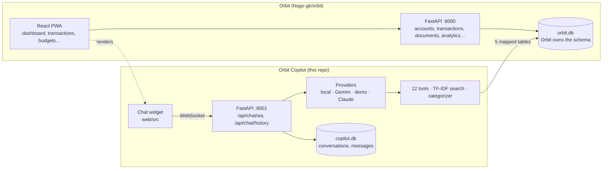

# Orbit Copilot architecture

## Components



Orbit's frontend renders the widget. The widget talks only to the copilot service. The copilot reads and writes Orbit's data through a fixed set of table mappings and keeps chat history in its own database.

## Data contract with Orbit

`orbit_copilot/models/orbit.py` is the contract. It maps these Orbit tables, column for column:

| Table | Copilot reads | Copilot writes |
| --- | --- | --- |
| `users` | id, email, created_at (identity only) | never |
| `transactions` | yes | insert (`create_transaction`) |
| `accounts` | yes | insert, update name/balance |
| `subscriptions` | yes | set `active = false` |
| `documents` | content for search | never |
| `net_worth_snapshots` | mapped, not used yet | never |

Rules:

- Orbit creates and migrates these tables. The copilot never calls `create_all` on them.
- If Orbit changes one of these columns, the same release updates this file.
- Chat tables (`conversations`, `messages`) moved out of Orbit's database into `copilot.db`. `user_id` there is a plain string holding Orbit's `users.id`.

This was chosen over calling Orbit's REST API so every tool behaves exactly as it did inside Orbit. Moving to the API later needs three Orbit endpoints that don't exist today: category breakdown, cancel subscription and document search.

## Identity

`auth.resolve_user_id(token)`:

1. If there's a valid Orbit JWT (`sub` = Orbit `users.id`, HS256, `ORBIT_JWT_SECRET`) and that user exists, use it.
2. Otherwise, if `ALLOW_LOCAL_USER` is on, use the oldest Orbit user. This replaces the hardcoded email that used to sit in Orbit's chat router.
3. Otherwise refuse: the WebSocket closes with code 4401 and the REST endpoints return 401.

Orbit's frontend currently sends the placeholder `local-bypass-token`, which isn't a JWT, so local mode applies. That matches how Orbit behaves today.

## One chat turn

1. The client sends `{message, conversation_id}`.
2. The copilot finds or creates the conversation in `copilot.db`, loads the last 20 messages, and saves the user turn.
3. It picks a provider:
   - **Local:** OpenAI-compatible chat completions with the tools converted to function definitions, up to 5 tool rounds.
   - **Gemini:** `gemini-2.5-flash` with function declarations, up to 5 tool rounds.
   - **Demo:** regex intent detection → one tool or analytics call → formatted answer.
   - **Claude:** streamed; each `tool_use` block is run against Orbit's DB and the result is sent back as `tool_result`; this repeats until a round has no tool calls.
4. Non-streaming providers replay their tool calls first, then the text word by word, so the widget looks the same whichever provider ran.
5. The copilot saves the assistant turn (with a JSON tool-call log), auto-titles a new conversation from its first message, and sends `done`.

Errors inside a turn are sent as `{"type":"error"}` and the socket stays open for the next message.

## Layout

```text
orbit_copilot/
  main.py               FastAPI app, CORS, /health
  config.py             env settings
  db.py                 two engines: orbit (mapped) + copilot (owned)
  auth.py               JWT → user, local-mode fallback
  api/chat.py           WebSocket + history endpoints, agent loop
  providers/            anthropic, gemini, local, demo
  tools.py              tool schemas + handlers
  rag.py                TF-IDF document search
  categorizer.py        keyword + optional LLM categorization
  analytics.py          forecast, anomalies, insights (demo mode)
  prompts.py            system prompt (Claude)
  llm_utils.py          shared helpers
  models/orbit.py       Orbit table mappings (the contract)
  models/chat.py        conversations, messages
web/src/                React widget (ChatAssistant, useChat, useVoice)
tests/                  pytest suite
```
